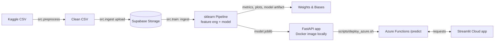

# 🏨 Will This Guest Cancel? — A Reproducible, Deployed ML Pipeline

Predicts the probability that a hotel booking will be cancelled, served from a live
API on **Azure Functions** and used by an interactive **Streamlit** app.

| | Link |
|---|---|
| **Live app** | https://hotel-cancel-debshree.streamlit.app |
| **API (Azure Functions)** | https://hotel-cancel-api-6b862d.azurewebsites.net — `POST /predict`, Swagger docs at [`/docs`](https://hotel-cancel-api-6b862d.azurewebsites.net/docs) |
| **W&B project** | https://forge.coreweave.com/wandb/debshree-chowdhury-duke-university/hotel-cancellation |
| **Dataset** | [Hotel Booking Demand (Kaggle)](https://www.kaggle.com/datasets/jessemostipak/hotel-booking-demand) |

---

## 1. Project overview & goals

Hotels overbook, adjust deposits and send reminders based on how likely a booking is to
be cancelled. We built an end-to-end MLOps system around that question:

- **Data** cleaned locally and hosted in **Supabase Storage**; the pipeline downloads it programmatically (Google Cloud Storage is supported as an alternative).
- **Reproducible pipeline**: ingestion → preprocessing & feature engineering → train/val/test split → training → evaluation, all controlled by `config.yaml`.
- **Experiment tracking** with **Weights & Biases** (params, metrics, plots, versioned model artifact).
- **One Docker image** with entry points for training and serving.
- **FastAPI** `/predict` endpoint deployed to **Azure Functions** (Flex Consumption).
- **Streamlit** front end, hosted on **Streamlit Community Cloud**, that calls the live API.



## 2. Dataset

**Hotel Booking Demand** — Antonio, Almeida & Nunes (2019), *Data in Brief* 22:41–49.
119,390 bookings (2015–2017) from a city hotel and a resort hotel in Portugal, 32 columns.

- **Target:** `is_canceled` (1 = booking cancelled). About 37% of raw rows (≈27% after de-duplication) are cancellations.
- **Cleaning (`src/preprocess.py`):**
  - Dropped **leakage** columns that are only known after the outcome: `reservation_status`, `reservation_status_date`, `assigned_room_type`.
  - Dropped high-missingness ID columns `agent` and `company`.
  - Filled missing `children` with 0 and missing `country` with `"Unknown"`; merged meal `Undefined` into `SC`.
  - Removed bookings with zero guests, negative `adr`, or `adr` > 1000 (outliers).
  - Removed exact duplicate rows (~30k).
- **Feature engineering (inside the model pipeline, `src/features.py`):** `total_nights`, `total_guests`, standard scaling of numeric fields, and one-hot encoding with rare-category grouping. Because these live in the saved `Pipeline`, the API accepts raw booking fields and there is no training/serving skew.

## 3. Model & evaluation

- **Default model:** `HistGradientBoostingClassifier`. Swap to `random_forest` or `logistic_regression` with one config change.
- **Split:** 70 / 15 / 15 train / validation / test, stratified, seed 42.
- **Metrics:** ROC-AUC (primary), PR-AUC, F1, precision, recall and accuracy at a 0.5 threshold.

Deployed model (`hist_gradient_boosting-1122-170655`). Data: 119,390 raw bookings → 85,950 after cleaning and de-duplication, downloaded from Supabase Storage at training time; split 60,164 / 12,893 / 12,893; cancellation rate 27.6%.

| Split | ROC-AUC | PR-AUC | F1 | Precision | Recall | Accuracy |
|---|---|---|---|---|---|---|
| Validation | 0.845 | 0.708 | 0.590 | 0.729 | 0.496 | 0.810 |
| **Test** | **0.843** | **0.691** | **0.584** | **0.711** | **0.495** | **0.805** |

Most important features (permutation importance, drop in ROC-AUC): `lead_time` (0.089),
`required_car_parking_spaces` (0.069), `total_of_special_requests` (0.061), `market_segment` (0.054), `adr` (0.037).

At the default 0.5 threshold the model is precise but misses about half of the cancellations; lowering
`model.threshold` trades precision for recall.

Model comparison (same data, split and seed; all runs tracked in W&B):

| Model | Val ROC-AUC | Test ROC-AUC | Test PR-AUC | Test F1 | W&B run |
|---|---|---|---|---|---|
| **hist_gradient_boosting (deployed)** | **0.845** | **0.843** | **0.691** | **0.584** | [26siw72k](https://forge.coreweave.com/wandb/debshree-chowdhury-duke-university/hotel-cancellation/runs/26siw72k) |
| random_forest | 0.837 | 0.833 | 0.674 | 0.550 | [47fwikpd](https://forge.coreweave.com/wandb/debshree-chowdhury-duke-university/hotel-cancellation/runs/47fwikpd) |
| logistic_regression | 0.801 | 0.796 | 0.620 | 0.495 | [2b9k8fg8](https://forge.coreweave.com/wandb/debshree-chowdhury-duke-university/hotel-cancellation/runs/2b9k8fg8) |

Gradient boosting has the best ROC-AUC, PR-AUC and F1 (random forest is slightly more precise but misses more cancellations) and is also the smallest artifact (0.3 MB vs 9 MB for the
random forest), so it is the model we deploy.
> Plots (`reports/`): confusion matrix, ROC curve and permutation feature importance, all also logged to W&B.

## 4. Cloud services used

| Service | Purpose |
|---|---|
| Supabase Storage | Hosts the cleaned dataset (bucket `hotel-data`, file `hotel_bookings_clean.csv`) |
| Azure Functions (Flex Consumption, Python 3.11) | Serves the FastAPI model API (scales to zero); deployed with `scripts/deploy_azure.sh` |
| Azure Storage + Application Insights | Created automatically for the Function App (package storage, logs) |
| Weights & Biases | Experiment tracking and model artifact versioning |
| Streamlit Community Cloud | Hosts the front end |
| GitHub Actions | Runs tests and a Docker smoke-test on every PR |

## 5. Repository structure

```
├── config.yaml              # all pipeline parameters
├── Dockerfile, entrypoint.sh  # one image: train | serve | preprocess | sample
├── requirements.txt         # pinned runtime deps (pipeline + API)
├── requirements-dev.txt     # + pytest, httpx, streamlit
├── src/
│   ├── config.py            # YAML loading + env/CLI overrides
│   ├── preprocess.py        # raw Kaggle CSV -> clean CSV
│   ├── ingest.py            # GCS upload/download + load for training
│   ├── features.py          # feature engineering + sklearn Pipeline
│   ├── evaluate.py          # metrics + plots
│   ├── tracking.py          # Weights & Biases wrapper
│   └── train.py             # the end-to-end pipeline
├── api/                     # FastAPI app + Pydantic schemas
├── frontend/                # Streamlit app (+ its own requirements.txt)
├── deploy/azure/            # Azure Functions wrapper (function_app.py, host.json, slim requirements)
├── scripts/                 # setup + deploy scripts, sample request, synthetic data generator
├── tests/                   # pytest suite (runs on synthetic data)
└── .github/workflows/ci.yml
```

## 6. Setup & usage

### Quick start (one command)
```bash
git clone https://github.com/debshreechowdhury/hotel-cancellation-mlops.git && cd hotel-cancellation-mlops
./scripts/setup_local.sh      # data -> Supabase, train 3 models, test the API
./scripts/deploy_azure.sh     # deploy the API to Azure Functions
```
`setup_local.sh` creates the venv, installs dependencies, unzips the Kaggle download from
`~/Downloads/archive.zip`, preprocesses, asks once for your Supabase URL/secret key (saved to the
git-ignored `.env`), uploads the data, logs in to W&B, trains three models (downloading the data
from Supabase), smoke-tests the API and prints the metrics. Both scripts are safe to re-run.
The sections below are the same steps done by hand.

### 6.0 Prerequisites
- Python 3.11–3.13, Docker (for the container steps), free accounts on [Supabase](https://supabase.com),
  [Azure for Students](https://azure.microsoft.com/free/students) (no credit card) and [W&B](https://wandb.ai).

```bash
python3.11 -m venv .venv && source .venv/bin/activate
pip install -r requirements-dev.txt
cp .env.example .env      # then fill in SUPABASE_URL and SUPABASE_KEY (secret key)
wandb login               # paste your API key
```

### 6.1 Get the data and host it in Supabase
```bash
# 1. Download hotel_bookings.csv from Kaggle into data/raw/
# 2. Clean it
python -m src.preprocess                     # -> data/processed/hotel_bookings_clean.csv
# 3. Upload (creates the private bucket "hotel-data" if needed; uses SUPABASE_URL/KEY from .env)
python -m src.ingest upload
```
*Alternative:* Google Cloud Storage — set `data.source: gcs` and `data.gcs_bucket`, run
`gcloud auth application-default login`, then the same `python -m src.ingest upload`.

### 6.2 Train the model
```bash
python -m src.train                                   # downloads from Supabase, trains, logs to W&B
python -m src.train --set model.type=random_forest    # another experiment
python -m src.train --set features.include_country=true --set model.threshold=0.4
```
Outputs: `models/model.joblib`, `models/metadata.json`, and plots in `reports/`.

**Train inside Docker (fully reproducible):**
```bash
docker build -t hotel-cancel .
docker run --rm --env-file .env -e WANDB_API_KEY=$WANDB_API_KEY \
  -v "$(pwd)/models:/app/models" \
  hotel-cancel train
```
(On Linux, add `--user "$(id -u):$(id -g)"` so the model files are owned by you.)
No credentials? `docker run --rm hotel-cancel sample` runs the whole pipeline on synthetic data as a smoke test.

### 6.3 Build and test the API locally
```bash
uvicorn api.main:app --reload --port 8080            # or, after training:
docker build -t hotel-cancel . && docker run --rm -p 8080:8080 hotel-cancel serve

curl http://localhost:8080/health
curl -X POST http://localhost:8080/predict \
     -H "Content-Type: application/json" -d @scripts/sample_request.json
# -> {"cancel_probability":0.87,"will_cancel":true,"risk_level":"high",...}
```
Interactive docs: http://localhost:8080/docs. Every field has a default, so partial payloads such as `{"lead_time": 200}` work too.

### 6.4 Deploy the API to Azure Functions
```bash
./scripts/deploy_azure.sh
```
The script installs the Azure CLI if missing (Homebrew), logs in, creates
a resource group, storage account and a **Flex Consumption** Python 3.11 Function App, packages
`api/`, `src/`, the trained model and `deploy/azure/` (`function_app.py` wraps the same FastAPI app
with `AsgiFunctionApp`; `host.json` removes the default `/api` prefix), publishes it, and calls `/health` and `/predict` on the live URL. Resource names are saved in
`.azure-deploy.env`, so re-running it redeploys the same app. Deployment is a zip deploy with a
remote build (`az functionapp deployment source config-zip --build-remote true`), so Azure
Functions Core Tools are not needed.
Azure for Students limits regions; if creation is refused, run `LOCATION=westus2 ./scripts/deploy_azure.sh`.

Verify:
```bash
curl -X POST https://<app>.azurewebsites.net/predict -H "Content-Type: application/json" -d @scripts/sample_request.json
```
*Alternative:* Google Cloud Run — `PROJECT_ID=<id> ./scripts/deploy_cloud_run.sh` (needs a billing-enabled GCP project).

### 6.5 Run / deploy the front end
```bash
API_URL=https://<app>.azurewebsites.net streamlit run frontend/app.py
```
**Streamlit Community Cloud:** New app → pick this repo → main file `frontend/app.py` →
Advanced settings → Secrets: `API_URL = "https://<app>.azurewebsites.net"` → Deploy.

### 6.6 Tests
```bash
pytest -q        # synthetic data, no cloud access needed
```

## 7. Ethics & limitations

> TODO (teammate PR — see `docs/TEAMMATE_TASK.md`).

## 8. Collaboration workflow

- `main` is protected; all work lands through feature branches and pull requests.
- CI (tests + Docker build) must pass before merging.
- PRs: see the repository's *Pull requests* tab (each team member opened at least one).

## 9. Team

- `TODO: Name 1` — data pipeline, training, API, deployment
- `TODO: Name 2` — front-end presets, ethics & limitations, model comparison
