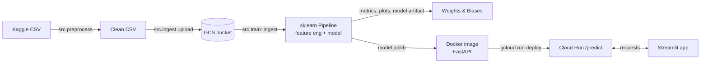

# 🏨 Will This Guest Cancel? — A Reproducible, Deployed ML Pipeline

Predicts the probability that a hotel booking will be cancelled, served from a live
API on **Google Cloud Run** and used by an interactive **Streamlit** app.

| | Link |
|---|---|
| **Live app** | `TODO: https://<your-app>.streamlit.app` |
| **API (Cloud Run)** | `TODO: https://hotel-cancel-api-XXXX.run.app` — Swagger docs at `/docs` |
| **W&B project** | `TODO: https://wandb.ai/<entity>/hotel-cancellation` |
| **Dataset** | [Hotel Booking Demand (Kaggle)](https://www.kaggle.com/datasets/jessemostipak/hotel-booking-demand) |

---

## 1. Project overview & goals

Hotels overbook, adjust deposits and send reminders based on how likely a booking is to
be cancelled. We built an end-to-end MLOps system around that question:

- **Data** cleaned locally and hosted in **Google Cloud Storage**; the pipeline downloads it programmatically.
- **Reproducible pipeline**: ingestion → preprocessing & feature engineering → train/val/test split → training → evaluation, all controlled by `config.yaml`.
- **Experiment tracking** with **Weights & Biases** (params, metrics, plots, versioned model artifact).
- **One Docker image** with entry points for training and serving.
- **FastAPI** `/predict` endpoint deployed to **Cloud Run**.
- **Streamlit** front end, hosted on **Streamlit Community Cloud**, that calls the live API.



## 2. Dataset

**Hotel Booking Demand** — Antonio, Almeida & Nunes (2019), *Data in Brief* 22:41–49.
119,390 bookings (2015–2017) from a city hotel and a resort hotel in Portugal, 32 columns.

- **Target:** `is_canceled` (1 = booking cancelled). About 37% of raw rows (≈27% after de-duplication) are cancellations.
- **Cleaning (`src/preprocess.py`):**
  - Dropped **leakage** columns that are only known after the outcome: `reservation_status`, `reservation_status_date`, `assigned_room_type`.
  - Dropped high-missingness ID columns `agent` and `company`.
  - Filled missing `children` with 0 and missing `country` with `"Unknown"`; merged meal `Undefined` into `SC`.
  - Removed bookings with zero guests, negative `adr`, or `adr` > 1000 (outliers).
  - Removed exact duplicate rows (~30k).
- **Feature engineering (inside the model pipeline, `src/features.py`):** `total_nights`, `total_guests`, standard scaling of numeric fields, and one-hot encoding with rare-category grouping. Because these live in the saved `Pipeline`, the API accepts raw booking fields and there is no training/serving skew.

## 3. Model & evaluation

- **Default model:** `HistGradientBoostingClassifier`. Swap to `random_forest` or `logistic_regression` with one config change.
- **Split:** 70 / 15 / 15 train / validation / test, stratified, seed 42.
- **Metrics:** ROC-AUC (primary), PR-AUC, F1, precision, recall and accuracy at a 0.5 threshold.

| Model | Val ROC-AUC | Test ROC-AUC | Test F1 | W&B run |
|---|---|---|---|---|
| hist_gradient_boosting | TODO | TODO | TODO | TODO |
| random_forest | TODO | TODO | TODO | TODO |
| logistic_regression | TODO | TODO | TODO | TODO |

> Fill this from `models/metadata.json` or the W&B dashboard after each run.
> Plots (`reports/`): confusion matrix, ROC curve and permutation feature importance, all also logged to W&B.

## 4. Cloud services used

| Service | Purpose |
|---|---|
| Google Cloud Storage | Hosts the cleaned dataset (`gs://<bucket>/data/hotel_bookings_clean.csv`) |
| Google Cloud Build + Artifact Registry | Builds the Docker image from source |
| Google Cloud Run | Serves the FastAPI model API (scales to zero) |
| Weights & Biases | Experiment tracking and model artifact versioning |
| Streamlit Community Cloud | Hosts the front end |
| GitHub Actions | Runs tests and a Docker smoke-test on every PR |

## 5. Repository structure

```
├── config.yaml              # all pipeline parameters
├── Dockerfile, entrypoint.sh  # one image: train | serve | preprocess | sample
├── requirements.txt         # pinned runtime deps (pipeline + API)
├── requirements-dev.txt     # + pytest, httpx, streamlit
├── src/
│   ├── config.py            # YAML loading + env/CLI overrides
│   ├── preprocess.py        # raw Kaggle CSV -> clean CSV
│   ├── ingest.py            # GCS upload/download + load for training
│   ├── features.py          # feature engineering + sklearn Pipeline
│   ├── evaluate.py          # metrics + plots
│   ├── tracking.py          # Weights & Biases wrapper
│   └── train.py             # the end-to-end pipeline
├── api/                     # FastAPI app + Pydantic schemas
├── frontend/                # Streamlit app (+ its own requirements.txt)
├── scripts/                 # deploy script, sample request, synthetic data generator
├── tests/                   # pytest suite (runs on synthetic data)
└── .github/workflows/ci.yml
```

## 6. Setup & usage

### Quick start (one command)
```bash
git clone https://github.com/debshreechowdhury/hotel-cancellation-mlops.git && cd hotel-cancellation-mlops
GCS_BUCKET=<your-bucket> ./scripts/setup_local.sh   # omit GCS_BUCKET to keep data local
```
`scripts/setup_local.sh` creates the venv, installs dependencies, unzips the Kaggle download from
`~/Downloads/archive.zip`, preprocesses, uploads to GCS, logs in to W&B, trains three models,
smoke-tests the API and prints the metrics. It is safe to re-run. The sections below are the same
steps done by hand.

### 6.0 Prerequisites
- Python 3.11, Docker, the [gcloud CLI](https://cloud.google.com/sdk/docs/install), a GCP project with billing, and a free [W&B](https://wandb.ai) account.

```bash
python3.11 -m venv .venv && source .venv/bin/activate
pip install -r requirements-dev.txt
gcloud auth login
gcloud auth application-default login        # lets Python read/write GCS
wandb login                                  # paste your API key
```

### 6.1 Get the data and host it in GCS
```bash
# 1. Download hotel_bookings.csv from Kaggle into data/raw/
# 2. Clean it
python -m src.preprocess                     # -> data/processed/hotel_bookings_clean.csv
# 3. Create a bucket and upload (bucket names are global — pick a unique one)
gcloud storage buckets create gs://YOUR_BUCKET_NAME --location=us-east1
# set data.gcs_bucket in config.yaml (or export GCS_BUCKET=YOUR_BUCKET_NAME), then:
python -m src.ingest upload
```

### 6.2 Train the model
```bash
python -m src.train                                   # downloads from GCS, trains, logs to W&B
python -m src.train --set model.type=random_forest    # another experiment
python -m src.train --set features.include_country=true --set model.threshold=0.4
```
Outputs: `models/model.joblib`, `models/metadata.json`, and plots in `reports/`.

**Train inside Docker (fully reproducible):**
```bash
docker build -t hotel-cancel .
docker run --rm \
  -e WANDB_API_KEY=$WANDB_API_KEY \
  -e GCS_BUCKET=YOUR_BUCKET_NAME -e GOOGLE_CLOUD_PROJECT=your-gcp-project \
  -e GOOGLE_APPLICATION_CREDENTIALS=/tmp/adc.json \
  -v ~/.config/gcloud/application_default_credentials.json:/tmp/adc.json:ro \
  -v "$(pwd)/models:/app/models" \
  hotel-cancel train
```
(On Linux, add `--user "$(id -u):$(id -g)"` so the model files are owned by you.)
No credentials? `docker run --rm hotel-cancel sample` runs the whole pipeline on synthetic data as a smoke test.

### 6.3 Build and test the API locally
```bash
uvicorn api.main:app --reload --port 8080            # or, after training:
docker build -t hotel-cancel . && docker run --rm -p 8080:8080 hotel-cancel serve

curl http://localhost:8080/health
curl -X POST http://localhost:8080/predict \
     -H "Content-Type: application/json" -d @scripts/sample_request.json
# -> {"cancel_probability":0.87,"will_cancel":true,"risk_level":"high",...}
```
Interactive docs: http://localhost:8080/docs. Every field has a default, so partial payloads such as `{"lead_time": 200}` work too.

### 6.4 Deploy the API to Cloud Run
```bash
PROJECT_ID=your-gcp-project ./scripts/deploy_cloud_run.sh
```
This builds the image with Cloud Build (the trained `models/model.joblib` is baked in;
`.gcloudignore` makes sure it is uploaded) and deploys a public service. Verify:
```bash
curl -X POST https://<service-url>/predict -H "Content-Type: application/json" -d @scripts/sample_request.json
```

### 6.5 Run / deploy the front end
```bash
API_URL=https://<service-url> streamlit run frontend/app.py
```
**Streamlit Community Cloud:** New app → pick this repo → main file `frontend/app.py` →
Advanced settings → Secrets: `API_URL = "https://<service-url>"` → Deploy.

### 6.6 Tests
```bash
pytest -q        # synthetic data, no cloud access needed
```

## 7. Ethics & limitations

> TODO (teammate PR — see `docs/TEAMMATE_TASK.md`).

## 8. Collaboration workflow

- `main` is protected; all work lands through feature branches and pull requests.
- CI (tests + Docker build) must pass before merging.
- PRs: see the repository's *Pull requests* tab (each team member opened at least one).

## 9. Team

- `TODO: Name 1` — data pipeline, training, API, deployment
- `TODO: Name 2` — front-end presets, ethics & limitations, model comparison
